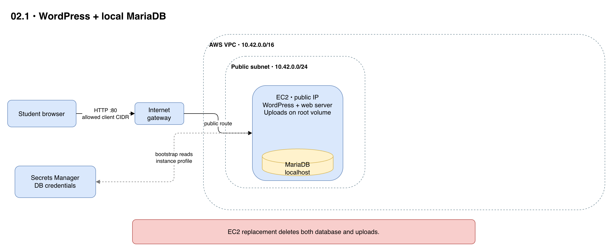

# 02.1 · WordPress and MariaDB on EC2

## Goal

WordPress and MariaDB share one instance and its root volume. See what happens when the instance is replaced.



[Editable architecture diagram](diagram.drawio)

## Deploy

- Follow the [shared setup and safety guidance](../README.md) in the same terminal. You need Terraform >= 1.10 and Academy permissions for S3 locking, VPC, EC2 and Secrets Manager.
- `LabInstanceProfile` must read the secret and, for Session Manager, have SSM permissions and connectivity. If it cannot, ask the instructor for an authorized profile and pass `-var="instance_profile_name=..."`. This lab does not change IAM.
- From this directory:

```sh
terraform init -backend-config="bucket=$TF_VAR_state_bucket"
terraform apply
terraform output -raw url
```

- `apply` does not wait for cloud-init. Wait for `BOOTSTRAP READY` in EC2 system output or `/var/log/wordpress-bootstrap.log` through Session Manager. If you see `BOOTSTRAP FAILED`, inspect the log, permissions and connectivity without disclosing secrets.
- Open the URL and complete setup. HTTP is open to the Internet and unencrypted: use synthetic data and disposable passwords. State and retained versions contain secrets; do not share or commit them.

## Experiment

- Create a post and upload an image. Replace only EC2:

```sh
terraform apply -replace=aws_instance.wordpress
terraform output -raw url
```

- Wait for `BOOTSTRAP READY`: the post, image and account disappear with the old volume. The IP may change; after a stop/start that changes it, replace EC2 to regenerate the URL. Replacement also ends existing sessions.

## Clean up

- Run `terraform destroy`: the database and files are lost and the secret is deleted without recovery.
- Check for billable leftovers. Keep the shared state bucket and protect its retained versions.
