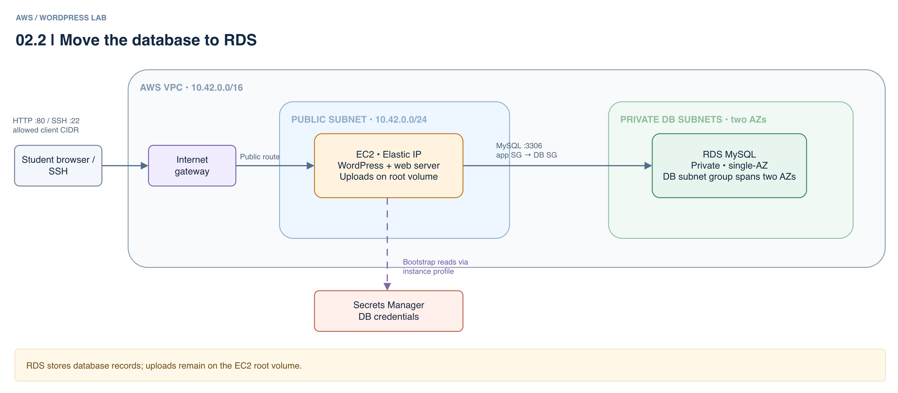

# 02.2 · WordPress on EC2 with RDS

## Goal

Separate WordPress from its private MySQL RDS database and compare what survives EC2 replacement. The connection verifies the AWS CA; WordPress uses the RDS administrator as a teaching simplification.



[Editable architecture diagram](assets/architecture.drawio). The PNG is a simplified view; the public address is an Elastic IP and SSH is also available.

## Deploy

- Follow the [shared setup and safety guidance](../README.md) in the same terminal. You need Terraform >= 1.10 and Academy permissions for S3 locking, VPC, EC2, RDS and Secrets Manager.
- `LabInstanceProfile` must read the secret and, for Session Manager, have SSM permissions and connectivity. If it cannot, ask the instructor for an authorized profile and pass `-var="instance_profile_name=..."`. This lab does not change IAM.
- The existing EC2 key pair defaults to Academy's `vockey`. Obtain its matching PEM from Academy and keep it outside this repository. For a different existing key pair, pass `-var="ssh_key_name=..."`.
- HTTP and SSH use the same `allowed_http_cidr`; its default `0.0.0.0/0` exposes both ports to the Internet. SSH is encrypted, but HTTP is not. To see your current public IPv4 and optionally restrict both ports to it, run:

```sh
curl -4 https://checkip.amazonaws.com
export TF_VAR_allowed_http_cidr="$(curl -4fsS https://checkip.amazonaws.com)/32"
```

  Keep this variable in the same terminal for subsequent `apply` and `destroy` commands. If your public IP changes, update it and apply again; an approved network CIDR can also be used. To return to the open default, run `unset TF_VAR_allowed_http_cidr` and apply again.
- From this directory:

```sh
terraform init -backend-config="bucket=$TF_VAR_state_bucket"
terraform apply
terraform output -raw url
```

- `apply` does not wait for cloud-init and RDS can take several minutes. Wait for `BOOTSTRAP READY` in EC2 system output or `/var/log/wordpress-bootstrap.log` through Session Manager. If you see `BOOTSTRAP FAILED`, inspect the log, permissions and connectivity without disclosing secrets.
- To inspect the instance over SSH with the PEM supplied by Academy (replace the path with your own):

```sh
chmod 400 /path/to/vockey.pem
ssh -i /path/to/vockey.pem "ec2-user@$(terraform output -raw public_ip)"
sudo cat /var/log/wordpress-bootstrap.log
```

- Never commit or share the PEM. Verify the instance host key fingerprint through a trusted channel; replacement changes the SSH host key, so verify the new fingerprint before updating a stale `known_hosts` entry.
- Open the URL and complete setup. HTTP is unencrypted: use synthetic data and disposable passwords. State and retained versions contain secrets; do not share or commit them.

## Experiment

- Create a post and upload an image. Replace only EC2:

```sh
terraform apply -replace=aws_instance.wordpress
terraform output -raw url
```

- After `BOOTSTRAP READY`, the post and administrator remain in RDS, but the image file is lost with the EC2 volume. Check the media library: the post HTML can retain the image URL even though the file is gone.
- The Elastic IP and WordPress URL remain the same across EC2 replacement and stop/start while the allocation is retained. Expect downtime during replacement; replacement ends existing sessions. Destroying or replacing the Elastic IP changes the URL.

## Clean up

- Run `terraform destroy`. RDS has no backups or final snapshot: its data is lost.
- Check for billable leftovers, including Elastic IP allocations (public IPv4 addresses incur charges even when idle). Keep the shared state bucket and protect its retained versions.
