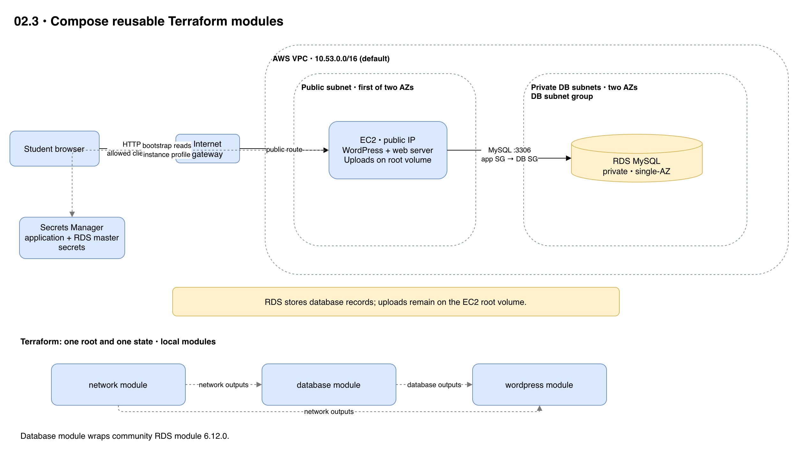

# 02.3 · WordPress with Terraform modules

## Goal

Reuse network, MySQL RDS and WordPress EC2 modules in one root and state. The local database module uses the [community RDS module](https://registry.terraform.io/modules/terraform-aws-modules/rds/aws/6.12.0), pinned to `6.12.0` and downloaded by `terraform init`.



[Editable architecture diagram](diagram.drawio)

## Deploy

- Follow the [shared setup and safety guidance](../README.md) in the same terminal. You need Terraform >= 1.10 and Academy permissions for S3 locking, EC2, RDS and Secrets Manager.
- `LabInstanceProfile` must read the application and RDS master secrets and use the applicable KMS key. Session Manager also requires SSM permissions and connectivity. The instructor can authorize another profile via `-var="instance_profile_name=..."`.
- The existing Academy EC2 key pair defaults to `vockey`; obtain its matching PEM from Academy and keep it outside the repository. Set `ssh_key_name` if the authorized key pair differs. The default `http_cidr` is `0.0.0.0/0`, exposing both HTTP and SSH to the Internet; optionally restrict it to your public IPv4 address as a `/32`.
  For example, before planning or applying, run `export TF_VAR_http_cidr="$(curl -4fsS https://checkip.amazonaws.com)/32"`; update it if your public IP changes.
- From this directory:

```sh
terraform init -backend-config="bucket=$TF_VAR_state_bucket"
terraform plan
terraform apply
terraform output -raw url
```

- Wait for cloud-init and complete setup. HTTP is unencrypted: use synthetic data and disposable passwords. To inspect `/var/log/infra-lab-bootstrap.log`, use Session Manager if authorized or SSH with your own PEM:

```sh
chmod 400 /path/to/vockey.pem
ssh -i /path/to/vockey.pem ec2-user@"$(terraform output -raw public_ip)"
```

- The allocated Elastic IP supplies the site URL and survives instance replacement while this state and allocation remain intact. Existing installations using a different URL may require a WordPress URL/content migration; replacing or destroying the allocation changes the address.
- State and retained versions contain the application password and salts; do not share or commit state or plans.

## Experiment

- Create a post and upload an image. Uploads remain on EC2 and are lost on replacement; records are in RDS.
- Inspect `main.tf` to see how network and database outputs connect the modules.

## Clean up

- Run `terraform destroy`. RDS has no backups or final snapshot: its data is lost.
- Check for billable EC2, Elastic IP, RDS, volume and secret leftovers. Public IPv4 addresses incur charges, including allocated Elastic IPs. Keep the shared state bucket and protect its retained versions.
