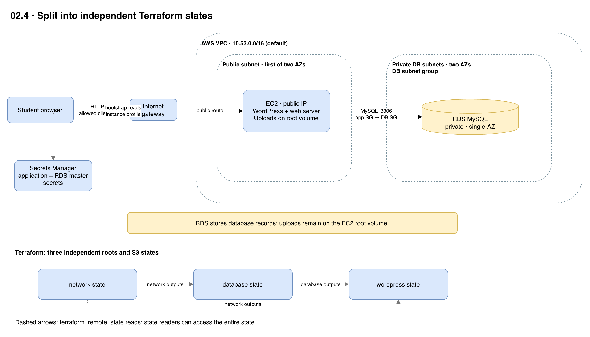

# 02.4 · WordPress with separate states

## Goal

Split the network, private RDS database and application into three states. Stages 02.5–02.7 reuse the network and database with their own application states.



[Editable architecture diagram](diagram.drawio)

## Deploy

- Follow the [shared setup](../README.md) in the same terminal, using your state bucket from lab 00. The default region is `us-east-1`.
- You need Terraform >= 1.10 and Academy permissions for S3 locking, EC2, RDS and Secrets Manager. `LabInstanceProfile` needs access to the application and RDS master secrets, the applicable KMS key and, for Session Manager, SSM permissions and connectivity.
- From the `02.4-multi-stack/` directory, deploy in order:

```sh
cd network
terraform init -backend-config="bucket=$TF_VAR_state_bucket"
terraform plan
terraform apply
cd ../database
terraform init -backend-config="bucket=$TF_VAR_state_bucket"
terraform plan
terraform apply
cd ../wordpress
terraform init -backend-config="bucket=$TF_VAR_state_bucket"
terraform plan
terraform apply
terraform output -raw url
```

- Wait for cloud-init and complete setup. HTTP is open to the Internet and unencrypted: use synthetic data and disposable passwords. If authorized, inspect `/var/log/infra-lab-bootstrap.log` through Session Manager.
- State and retained versions contain secrets. A `terraform_remote_state` reader can access the entire state, not just outputs.

## Experiment

- Create a post and upload an image: the database is in RDS, but uploads are lost when EC2 is replaced.
- Compare network and database outputs with the `terraform_remote_state` references. Re-plan dependent roots after changing a dependency: their locks are independent.

## Clean up

- From `wordpress/`, run `terraform destroy`. This application's database and user remain on RDS until an authorized administrator removes them or RDS is destroyed.
- Keep network and database while using 02.5–02.7. Once **all** dependent applications are destroyed, from `wordpress/`:

```sh
cd ../database
terraform destroy
cd ../network
terraform destroy
```

- Resolve application destroy failures first. RDS has no backups or final snapshot: destruction deletes its data. Check for billable leftovers and retain the state bucket as directed in lab 00.
