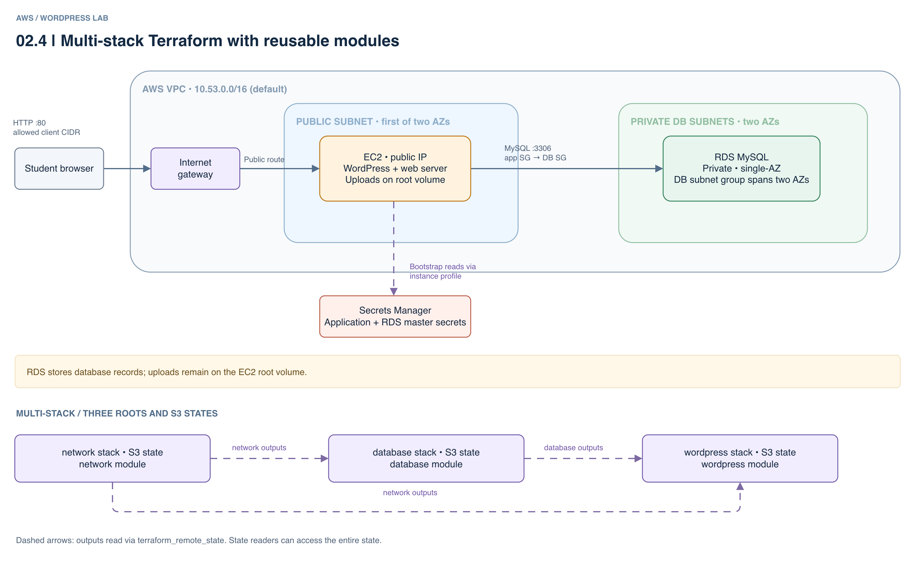

# 02.4 · WordPress with multiple Terraform stacks

## Goal

Use the same reusable network, MySQL/RDS and WordPress EC2 modules as 02.3, but deploy them from three independent Terraform roots and S3 states. The network root publishes VPC, subnet and security-group outputs; the database root reads them and publishes the RDS endpoint and secret ARNs; the WordPress root reads both states. Apply them in dependency order and destroy them in reverse order.

The database root owns one private RDS instance, the `wordpress` database and the 02.4 application secret. The EC2 bootstrap provisions the `wordpress_app` database user. Stages 02.5–02.7 reuse that RDS instance and network, but create their own application databases, users, secrets and independent states; their default `lab_id` values keep WordPress content separate. If overriding `lab_id`, use a different value for each stage.



[Editable architecture diagram](assets/architecture.drawio)

## Deploy

- Follow the [shared setup](../README.md) in the same terminal, using your state bucket from lab 00. The default region is `us-east-1`.
- You need Terraform >= 1.10 and Academy permissions for S3 locking, EC2, RDS and Secrets Manager. `LabInstanceProfile` needs access to the application and RDS master secrets, the applicable KMS key and, for Session Manager, SSM permissions and connectivity.
- The existing Academy EC2 key pair defaults to `vockey`; obtain its matching PEM from Academy and keep it outside the repository. Set `ssh_key_name` in the WordPress root if the authorized key pair differs. The network root's default `http_cidr` is `0.0.0.0/0`, exposing both HTTP and SSH to the Internet; optionally restrict it to your public IPv4 address as a `/32`.
  For example, before planning or applying the network, run `export TF_VAR_http_cidr="$(curl -4fsS https://checkip.amazonaws.com)/32"`; update it and reapply the network if your public IP changes.
- If you previously deployed an older 02.4 configuration, destroy its application, database and network in reverse dependency order using the old configuration first, or explicitly migrate its state and resources. Module resource addresses and the default resource name changed; applying this version directly is not a migration and can replace resources or lose data. The state keys remain unchanged.
- From the `02.4-multi-stack/` directory, deploy in order:

```sh
cd network
terraform init -backend-config="bucket=$TF_VAR_state_bucket"
terraform plan
terraform apply
cd ../database
terraform init -backend-config="bucket=$TF_VAR_state_bucket"
terraform plan
terraform apply
cd ../wordpress
terraform init -backend-config="bucket=$TF_VAR_state_bucket"
terraform plan
terraform apply
terraform output -raw url
```

- Wait for cloud-init and complete setup. HTTP is unencrypted: use synthetic data and disposable passwords. To inspect `/var/log/infra-lab-bootstrap.log`, use Session Manager if authorized or SSH from `wordpress/` with your own PEM:

```sh
chmod 400 /path/to/vockey.pem
ssh -i /path/to/vockey.pem ec2-user@"$(terraform output -raw public_ip)"
```

- The allocated Elastic IP supplies the site URL and survives instance replacement while this state and allocation remain intact. Existing installations using a different URL may require a WordPress URL/content migration; replacing or destroying the allocation changes the address.
- The three backend keys are `wordpress/network/terraform.tfstate`, `wordpress/database/terraform.tfstate` and `wordpress/application/terraform.tfstate`. State and retained versions contain secrets, including the 02.4 application credentials in the database state. A `terraform_remote_state` reader can access the entire state, not just outputs.

## Experiment

- Create a post and upload an image: the database is in RDS, but uploads are lost when EC2 is replaced.
- Compare network and database outputs with the `terraform_remote_state` references. Re-plan dependent roots after changing a dependency: their locks are independent.

## Clean up

- From `wordpress/`, run `terraform destroy`. The 02.4 application secret, database and user remain with the shared database stack; destroying the WordPress root does not delete them.
- Keep network and database while using 02.5–02.7. Once **all** dependent applications are destroyed, from `wordpress/`:

```sh
cd ../database
terraform destroy
cd ../network
terraform destroy
```

- Resolve application destroy failures first. RDS has no backups or final snapshot: destruction deletes its data. Check for billable leftovers, including Elastic IPs; public IPv4 addresses incur charges even when an Elastic IP is unassociated. Retain the state bucket as directed in lab 00.
