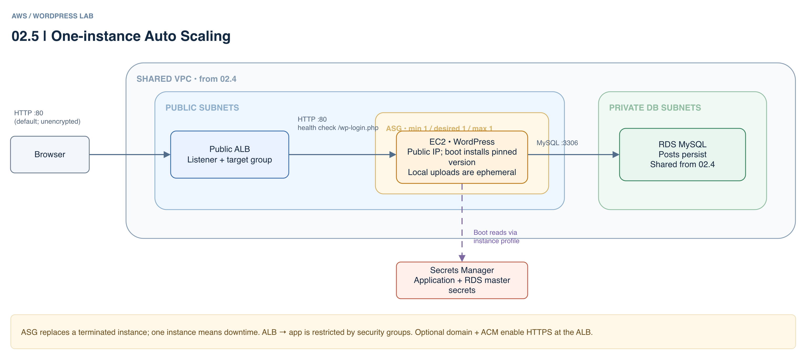

# 02.5 · WordPress with Auto Scaling

## Goal

Use a public load balancer and one-instance Auto Scaling Group (ASG) with the network and RDS from 02.4. Database records survive replacement; EC2 uploads do not.

[Editable architecture diagram](assets/architecture.drawio).



## Deploy

- Complete the [shared setup](../README.md) and deploy the network and database in [02.4](../02.4-multi-stack/README.md). You need Terraform >= 1.10, AWS CLI and Academy permissions for ALB, EC2, RDS and Secrets Manager.
- `LabInstanceProfile` must read the application and RDS master secrets and support SSM; the deployment identity must be able to pass the profile. Ask the instructor about Academy denies. States and retained versions contain secrets.
- From this directory:

```sh
terraform init -backend-config="bucket=$TF_VAR_state_bucket"
terraform plan
terraform apply
terraform output -raw application_url
```

- Version 6.7.1 is old and vulnerable; HTTP is public and unencrypted. Use an authorized isolated environment, synthetic data and disposable passwords.
- This lab deliberately lets the web server modify WordPress files to demonstrate version drift. Do not use this configuration in production.
- Wait for a healthy ALB target, open the URL and complete setup. Create a post and check the version in the dashboard.

## Experiment

- Manually update WordPress in the dashboard and record the version. Do not accept a database upgrade.
- In the AWS console, inspect the ASG and ALB target group health. Terminate this ASG's instance in EC2 without reducing desired capacity.
- Wait for the replacement target to become healthy and reopen the dashboard: the Terraform-pinned version returns and the post remains in RDS. One instance means downtime.
- Some Academy SCPs deny automatic ASG instance refresh, so replacement is manual. This does not undo database migrations and is not a production rollback.

## Clean up

- Run `terraform plan -destroy` and `terraform destroy` here. The application's database and user remain on RDS until an authorized administrator removes them or RDS is destroyed.
- Destroy all applications before the shared database and then the network, following [02.4](../02.4-multi-stack/README.md). Keep the state bucket, protect its versions and check for billable leftovers.
