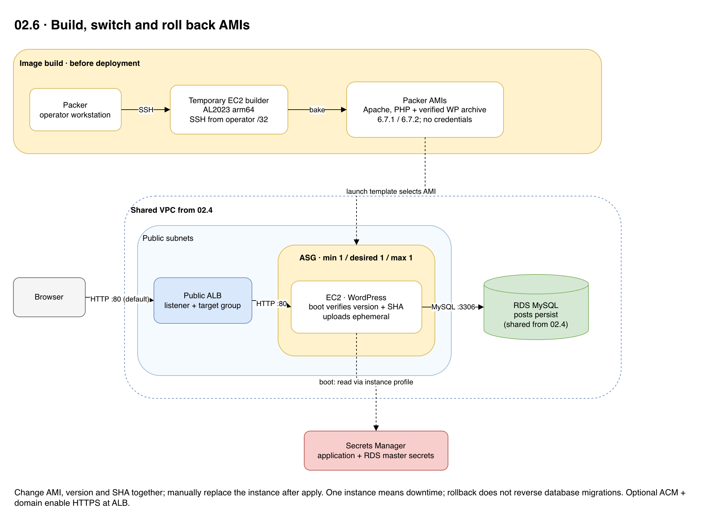

# 02.6 · WordPress with Packer AMIs

## Goal

Build two AMIs with Apache, PHP and a verified WordPress archive; switch and roll back the image used by an ASG. Credentials are fetched at boot, not baked into the AMI. Uploads remain ephemeral.

[Editable architecture diagram](diagram.drawio).



## Install and build

- macOS: install [Homebrew](https://brew.sh/), then run `brew tap hashicorp/tap` and `brew install hashicorp/tap/packer`.
- Windows: download the AMD64 ZIP from [Packer](https://developer.hashicorp.com/packer/install), extract `packer.exe` into a directory on your `PATH` and open a new PowerShell window. Check with `packer version`. The commands below use a shell; adapt variable assignments for PowerShell.
- You need Terraform >= 1.10, AWS CLI and Academy permissions to create and clean up the EC2 builder, temporary key and security group, snapshot and AMI. Ask the instructor for an authorized public subnet with Internet access. Temporary builder SSH must use your machine's public IP `/32`, never the whole Internet.
- From this directory, replace the subnet and CIDR with real values:

```sh
export REGION=us-east-1
export SUBNET_ID=subnet-REPLACE
packer init .
packer build -var "region=$REGION" -var "subnet_id=$SUBNET_ID" -var 'ssh_cidr=YOUR_PUBLIC_IP/32' -var 'wordpress_version=6.7.1' -var 'wordpress_sha256=33529cd638c845007e8e0d26c91d60c9c16b822c849c8deead03d0c851a26deb' .
packer build -var "region=$REGION" -var "subnet_id=$SUBNET_ID" -var 'ssh_cidr=YOUR_PUBLIC_IP/32' -var 'wordpress_version=6.7.2' -var 'wordpress_sha256=cfd9c83cfa9dda0351898ea9b73f58995c817994a5424be18777f83e886a3cf6' .
```

- Record both AMI IDs produced by Packer, not the base AMI. If a build fails, check temporary resources and charges.

## Deploy and experiment

- Complete the [shared setup](../README.md) and deploy the network and database from [02.4](../02.4-multi-stack/README.md). Use `us-east-1` for both Packer and Terraform. Enter the real AMI IDs:

```sh
export AMI_V1=ami-PACKER_6_7_1_ID
export AMI_V2=ami-PACKER_6_7_2_ID
export TF_VAR_ami_id="$AMI_V1"
terraform init -backend-config="bucket=$TF_VAR_state_bucket"
terraform plan
terraform apply
terraform output -raw application_url
```

- The 6.7.x versions are old and vulnerable; HTTP is public and unencrypted. Use synthetic data, disposable passwords and an authorized isolated environment.
- Wait for a healthy target, complete setup, create a post and check version 6.7.1. Do not accept a database upgrade.
- Change the AMI, version and SHA together:

```sh
export TF_VAR_ami_id="$AMI_V2"
export TF_VAR_wordpress_version=6.7.2
export TF_VAR_wordpress_sha256=cfd9c83cfa9dda0351898ea9b73f58995c817994a5424be18777f83e886a3cf6
terraform plan
terraform apply
```

- Boot checks the baked archive against the configured version and SHA. Some Academy SCPs deny instance refresh, so manually terminate the ASG instance without reducing capacity. Wait for a healthy target and check version 6.7.2 and the post.
- To roll back, set `TF_VAR_ami_id="$AMI_V1"`, `TF_VAR_wordpress_version=6.7.1` and `TF_VAR_wordpress_sha256=33529cd638c845007e8e0d26c91d60c9c16b822c849c8deead03d0c851a26deb`; plan/apply and replace the instance again. One instance means downtime; rollback does not undo database migrations.

## Clean up

- Run `terraform plan -destroy` and `terraform destroy` here. The database and user remain on RDS until an administrator removes them or RDS is destroyed.
- Keep the 6.7.2 AMI for 02.7. When finished with both stages, deregister the AMIs and delete their snapshots after checking that nothing else uses them. Check for leftover builders, temporary keys and security groups.
- Destroy all applications before the database and then the network, following [02.4](../02.4-multi-stack/README.md). Keep the state bucket and check for billable leftovers.
