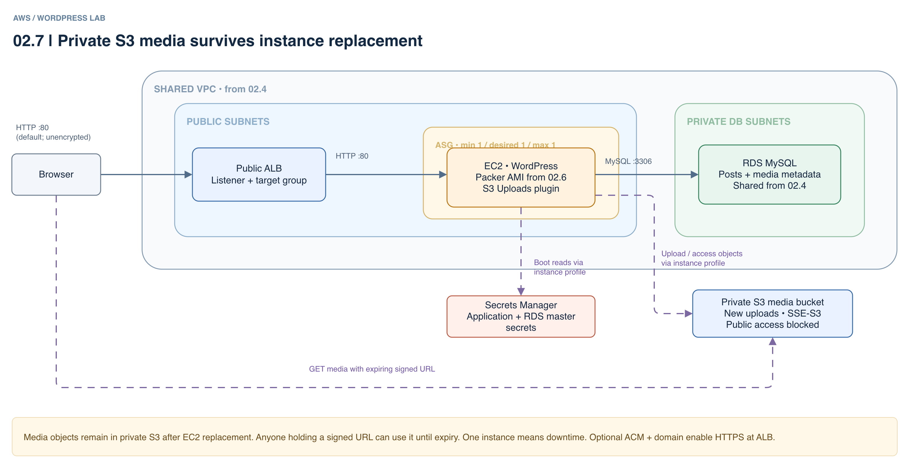

# 02.7 · WordPress media in S3

## Goal

Keep uploads when EC2 is replaced. This application reuses the network and RDS from 02.4, uses a public ALB and one-instance ASG, and stores new WordPress media in a private S3 bucket with [S3 Uploads](https://github.com/humanmade/S3-Uploads). Posts and metadata remain in RDS. Signed URLs expire, but anyone holding one can access it until then.

[Editable architecture diagram](assets/architecture.drawio).



## Deploy

- Complete the [shared setup](../README.md), deploy the network and database in [02.4](../02.4-multi-stack/README.md) and build the 6.7.2 AMI in [02.6](../02.6-ami/README.md). You need Terraform >= 1.10, AWS CLI and Academy permissions for Cloud Control, S3, EC2, ALB and secrets.
- `LabInstanceProfile` needs SSM and read access to the application and RDS master secrets. State and retained versions contain secrets. Version 6.7.2 is old and vulnerable; HTTP is public and unencrypted. Use an authorized isolated environment, synthetic data and disposable passwords.
- From this directory, enter the real Packer-built 6.7.2 AMI ID:

```sh
export TF_VAR_ami_id=ami-PACKER_6_7_2_ID
export TF_VAR_wordpress_version=6.7.2
export TF_VAR_wordpress_sha256=cfd9c83cfa9dda0351898ea9b73f58995c817994a5424be18777f83e886a3cf6
terraform init -backend-config="bucket=$TF_VAR_state_bucket"
terraform plan
terraform plan -target=awscc_s3_bucket.media
terraform apply -target=awscc_s3_bucket.media
export MEDIA_BUCKET="$(terraform output -raw media_bucket)"
echo "$MEDIA_BUCKET"
```

- This one-time targeted apply creates the bucket using **AWS Cloud Control** before instances start. Ask the instructor to check or grant the existing profile `s3:ListBucket` and `s3:GetBucketLocation` on the bucket ARN, and `s3:GetObject`, `s3:PutObject`, `s3:DeleteObject`, `s3:GetObjectAcl` and `s3:PutObjectAcl` on its `/*` object ARN. Academy explicit denies still apply. If permissions cannot be granted, stop; do not disable public access blocking or use static keys. The lab does not modify IAM.
- Always reconcile the complete configuration afterward:

```sh
terraform plan
terraform apply
terraform output -raw application_url
```

- Wait for a healthy ALB target and complete setup. Bootstrap needs access to WordPress.org, Composer/Packagist, S3, Secrets Manager and RDS. If it fails, inspect logs through SSM without disclosing credentials; after fixing permissions or connectivity, run `/opt/infra-lab/install.sh` on the instance.

## Experiment

- Upload a synthetic image in the media library, insert it into a post and confirm it renders. From an authorized CLI identity, check that private objects exist:

```sh
aws s3 ls "s3://$MEDIA_BUCKET/" --recursive
```

- In the AWS console, identify the ASG instance and check target health. Terminate that instance without reducing desired capacity. Wait for a healthy replacement and check the post, image and S3 objects again. There is downtime with one instance.
- If the image fails, inspect the plugin, profile and permissions; reload the page for a fresh signed URL. Do not share signed URLs or make the bucket public.

## Clean up

- Confirm the name and empty **only the media bucket**: `aws s3 rm "s3://$MEDIA_BUCKET/" --recursive`. If versioning was enabled separately, delete all versions and delete markers too.
- Run `terraform plan -destroy` and `terraform destroy`. The application's database and user remain on RDS until an administrator removes them or RDS is destroyed. Remove any temporary policy the instructor added.
- Destroy all applications before the shared database and then the network, following [02.4](../02.4-multi-stack/README.md). Keep the state bucket, protect its versions and check for billable leftovers.
